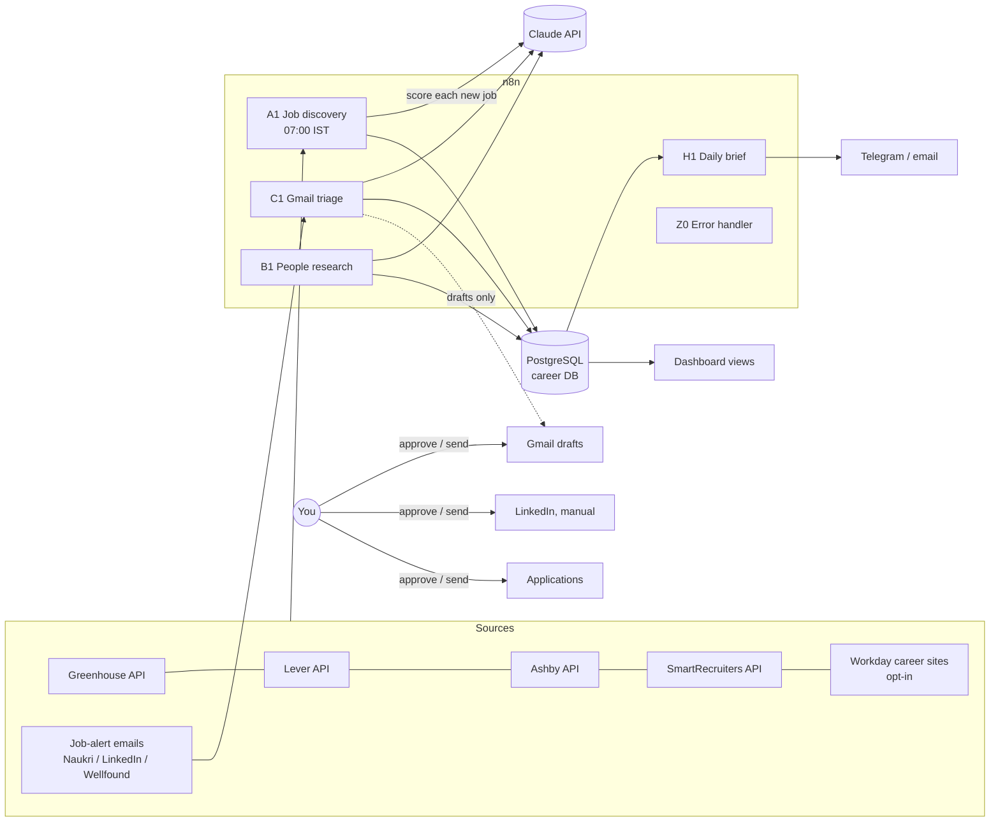

# Personal AI Career Agent

A job-switch operations system built on **n8n + PostgreSQL + Claude**. It does the research and
internal processing automatically and leaves every external action (applying, emailing, LinkedIn
messages, calendar invites) to you, behind an approval step.

Target: backend / Java / platform roles at ₹15–20 LPA in Mumbai, Bengaluru, Hyderabad, Pune or
remote, joining November 2026 – January 2027.

| Module | What it does | Status |
|---|---|---|
| **A. Job discovery** | Daily pull from company job boards, de-dupe, expiry, pre-filter, Claude 0–100 scoring | **Built and tested** |
| B. LinkedIn networking | People research from URLs you provide, drafted connection notes | Next |
| C. Gmail recruiter assistant | Classify/extract recruiter mail, draft replies (never auto-send) | Planned |
| D. Referral tracking | Follow-up timing with a hard cap of 2 follow-ups | Planned (tables exist) |
| E. Application tracker + dashboard | Status pipeline, duplicate-application guard | Planned (tables exist) |
| F. Resume / JD matching | ATS report, suggested edits, tailored version after approval | Planned |
| G. Interview prep | Prep pack from interview emails, calendar after approval | Planned |
| H. Daily career brief | Telegram/email morning summary | Planned |

Module A details, test results and how to run it: **[docs/module-a.md](docs/module-a.md)**.

---

## 1. Architecture



**Evaluation of the proposed architecture** (Job Sources → n8n → Claude → Matching → DB →
LinkedIn/Gmail → Notifications → Dashboard). The shape is right; the changes I made:

1. **Deterministic filter before Claude.** Most postings on a big board are irrelevant (wrong
   country, frontend, staff level). A regex/rules pre-filter in code drops ~70–90% of them for free,
   so Claude only scores plausible jobs. This is the biggest cost and noise lever.
2. **Claude never decides compensation.** The 10 compensation points are computed in code from
   salary data that is structured in the ATS feed or literally written in the JD. A salary quote
   from Claude is only accepted if it appears verbatim in the posting. Unknown salary scores a
   neutral 5/10 and is flagged `unknown`. Nothing is estimated.
3. **PostgreSQL, not Airtable.** Airtable's free tier caps a base at 1,000 records; job discovery
   alone stores thousands of rows a month, and the de-dupe / expiry logic needs real SQL
   (upserts, unique constraints, partial indexes). Postgres runs beside n8n at no cost. A dashboard
   can be views + Metabase/Grafana (or Google Sheets fed from a view) later.
4. **Modular workflows sharing one database**, one error-handler workflow, and an
   `execution_log` table every workflow writes to.
5. **LinkedIn is research + drafting only.** LinkedIn offers no API that lets an individual search
   people or send messages, and its terms prohibit scraping and automation. Module B works from
   profile URLs you paste (or that recruiters email you), stores them, and drafts notes you send by
   hand. Same for Naukri, Wellfound, Indeed and LinkedIn Jobs: no public job-seeker APIs, so they
   come in through their **job-alert emails** (Gmail API), parsed in a later workflow.

## 2. Integrations: free vs paid

| Component | Use | Cost |
|---|---|---|
| n8n (self-hosted, Community edition) | Orchestration | Free |
| PostgreSQL 16 | Data store | Free |
| Greenhouse / Lever / Ashby / SmartRecruiters public job-board APIs | Job discovery | Free, no key |
| Workday career-site JSON | Job discovery (opt-in per company) | Free; undocumented endpoint, check each site's terms |
| Claude API | Scoring, extraction, drafting | Pay per token |
| Gmail API, Google Calendar API (OAuth) | Modules C, G | Free |
| Telegram Bot API | Alerts, daily brief | Free |
| LinkedIn | Manual sending; optional Sales Navigator for search | Free / Sales Navigator is paid and optional |
| Hosting | One small VM, or your laptop | ₹0–500 / month |

## 3. Monthly cost estimate (INR)

Assumptions: ₹88 per USD; Claude Opus 5.5 at $4 / $20 per million input / output tokens; one
scoring call ≈ 2,500–3,000 input and ≈ 800 output tokens (prompt + JD in, thinking at `low` effort
plus a short JSON out) ≈ **$0.027 ≈ ₹2.4 per job**. Steady state ≈ 15–30 jobs/day pass the
pre-filter across 30 boards. These are estimates: after the first week, measure the real number
with the query in docs/module-a.md §8.

| Item | Lean | Comfortable |
|---|---|---|
| Hosting | ₹0 (laptop, or Oracle Cloud Always Free VM) | ₹450 (Hetzner CX22 / similar 2 vCPU 4 GB VPS) |
| Module A scoring, Opus 5.5 | ₹1,100–2,200 | same |
| Modules B–H on Claude (email triage ~20/day, drafts, prep packs, brief) | ~₹800–1,500 | ~₹1,500–2,500 |
| Everything else | ₹0 | ₹0 |
| **Total** | **≈ ₹2,000–3,700** | **≈ ₹3,000–5,000** |

The scoring model is one setting. Claude Sonnet 5.5 ($2 / $10) would cost roughly half for
scoring and Claude Haiku 5.5 ($0.10 / $0.50) roughly ₹50 a month; whether the cheaper models score
well enough for you is something to check on a sample before switching (docs/module-a.md §7).
The first run after setup will find a backlog; `max_jobs_scored_per_run` (default 60) caps a
single run at ≈ ₹150.

## 4. Database

One `career` database; full schema in [db/001_schema.sql](db/001_schema.sql), seed data
(profile, settings, ~30 target companies) in [db/002_seed.sql](db/002_seed.sql).

| Table | Module | Notes |
|---|---|---|
| `settings` | all | Candidate profile and per-module config as JSONB; workflows read it at run time |
| `companies`, `job_sources` | A | Category (product / fintech / saas_cloud / …) feeds the company score; sources track health and auto-disable |
| `discovery_runs` | A | One row per run with counts and per-source results |
| `jobs` | A | `UNIQUE(source_id, external_id)`; `fingerprint` for cross-board duplicates; expiry; pre-filter result |
| `job_scores` | A | Component scores, skills, flags, token usage; `UNIQUE(job_id, prompt_version)` |
| `execution_log` | all | Info/warn/error from every workflow and the error handler |
| `people`, `outreach_messages`, `referrals` | B, D | One live connect request per person (partial unique index); follow-ups capped at 2 |
| `applications`, `application_events`, `resume_versions` | E, F | One application per job (unique index) |
| `email_threads`, `interviews` | C, G | Gmail draft id stored; never sent automatically |
| `approvals` | all | Queue for every external action |
| `v_job_matches` | A, H | Latest score per job, used by the brief and dashboard |

## 5. Workflows

| ID | Workflow | Trigger | External actions |
|---|---|---|---|
| `careerA1Discover` | **A1 Job Discovery** | Daily 07:00 IST + manual | None (read-only HTTP GETs to job boards) |
| `careerZ0ErrorHnd` | **Z0 Error Handler** | Any workflow failure | Optional Telegram alert to you |
| — | A2 Job-alert email ingestion | Gmail, after Module C's OAuth setup | None |
| — | B1 People research, B2 Connection-note drafts | Manual / new target company | Drafts only |
| — | C1 Gmail triage, C2 Reply drafts | Gmail poll every 15 min | Gmail drafts only |
| — | D1 Referral follow-up planner | Daily | Drafts only |
| — | E1 Status sync + dashboard views | On change / daily | None |
| — | F1 JD vs resume report | Job marked `shortlisted` | Tailored resume only after approval |
| — | G1 Interview prep pack | Interview email detected | Calendar event after approval |
| — | H1 Daily brief | Daily 08:00 IST | Message to you only |

## 6. Repository layout

```
career-agent/
  docker-compose.yml        n8n 2.45.7 + Postgres 16, n8n bound to localhost
  .env.example              secrets template (copy to .env, git-ignored)
  db/                       schema + seed (applied automatically on first boot)
  deploy/initdb/            first-boot script: career DB + least-privilege role
  n8n/src/                  workflow logic: JS (discovery-lib.js, node glue) and SQL
  n8n/workflows/            generated, importable workflow JSON (do not hand-edit)
  scripts/build-workflows.mjs   n8n/src -> n8n/workflows
  scripts/bootstrap.sh      create n8n credentials from .env, import workflows
  scripts/verify-sources.sh check every job-board token once
  tests/                    unit tests + end-to-end test in a real n8n with mocks
  docs/module-a.md          Module A reference
```

## 7. Ground rules the system enforces

- Credentials only in n8n's encrypted credential store (created from `.env` by
  `scripts/bootstrap.sh`); workflows read configuration from the `settings` table, not env vars.
- Only official/public APIs and OAuth; no LinkedIn scraping or browser automation; one request per
  job board per day with a descriptive User-Agent.
- Nothing is sent, applied for or scheduled without your approval; drafts and queues only.
- Unique constraints prevent duplicate jobs, applications and connection requests.
- Every run is logged; failures route to the error workflow; HTTP calls have timeouts and retries.
